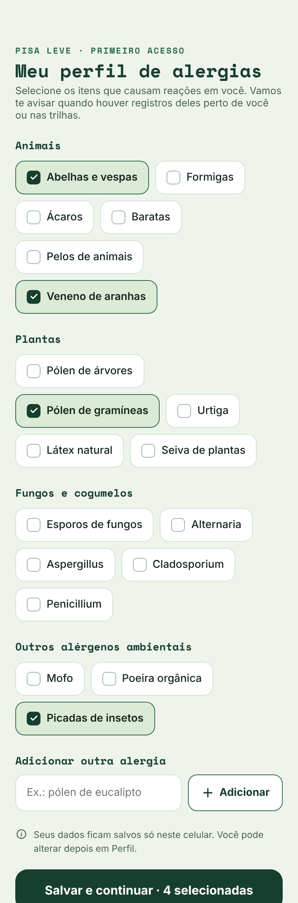
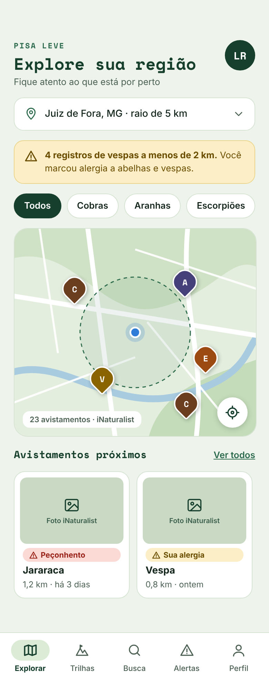
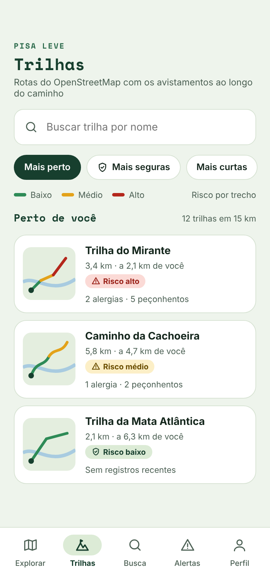
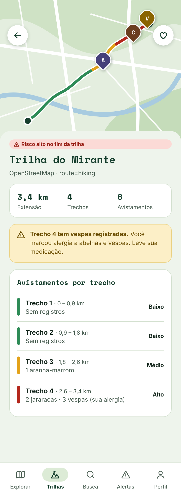
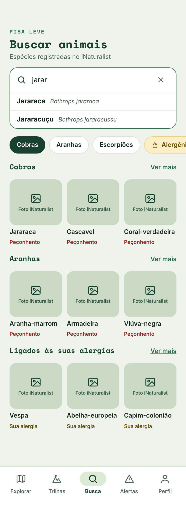
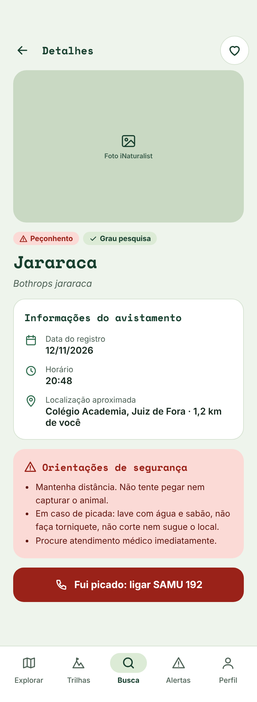
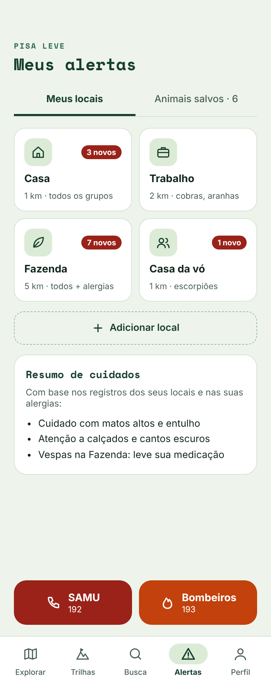
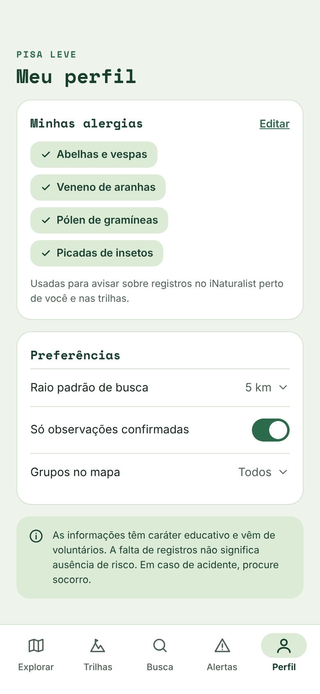

<h1 align="center">🥾 Pisa Leve</h1> 
 <strong>Saiba o que está por perto antes de dar o próximo passo.</strong>  Animais peçonhentos e alérgenos registrados perto de você e ao longo de trilhas, com avisos personalizados pelo seu perfil de alergias. 
 
     

📱 Sobre o projeto

O Pisa Leve é um aplicativo móvel que ajuda a prevenir acidentes com animais peçonhentos e reações alérgicas. Ele cruza dados reais de ciência cidadã com as informações do próprio usuário:

🗺️ Mapa de avistamentos: cobras, aranhas e escorpiões registrados perto de você.
🥾 Trilhas com risco por trecho: o percurso aparece no mapa pintado de verde, amarelo ou vermelho, conforme o que já foi visto em cada parte.
🤧 Perfil de alergias: no primeiro acesso você marca o que te causa reação, e o app avisa quando há registros disso por perto ou na trilha.
🔎 Busca de espécies pelo nome popular, com foto e orientações de segurança.
🔔 Alertas por local: acompanhe Casa, Trabalho ou Fazenda e veja quantos avistamentos novos surgiram.
🚑 Emergência a um toque: SAMU (192) e Corpo de Bombeiros (193).

⚠️ As informações têm caráter educativo e vêm de registros voluntários. A falta de registros não significa ausência de risco. Em caso de acidente, procure atendimento médico imediatamente.

🖼️ Telas

     
 
     

🚀 Como rodar localmente
Pré-requisitos
Ferramenta	Versão	Para quê
Node.js	22.13 ou superior (LTS)	Rodar o projeto
Git	qualquer recente	Clonar o repositório
Expo Go	compatível com o SDK 58	Abrir o app no celular
Passo a passo

1. Clone o repositório

bash
git clone https://github.com/LucaRenaultLamas/pisa-leve.git
cd pisa-leve

2. Instale as dependências

bash
npm install

3. Inicie o servidor do Expo

bash
npx expo start

4. Abra no celular

Android: abra o Expo Go e toque em Scan QR code.
iOS: aponte a câmera para o QR Code que aparece no terminal.

O celular e o computador precisam estar na mesma rede Wi-Fi. Se a rede bloquear a conexão (comum em redes de faculdade), use:

bash
npx expo start --tunnel

5. Permita o acesso à localização quando o app pedir. É com ela que o mapa e as trilhas mostram o que está perto de você.

Outros comandos úteis
Comando	O que faz
npx expo start -c	Inicia limpando o cache (resolve a maioria dos erros estranhos)
npx expo start --android	Abre direto no emulador Android
npx tsc --noEmit	Verifica erros de tipagem
🧭 Navegação

O app usa o file-based routing do Expo Router: cada arquivo em src/app/ é uma tela, e cada _layout.tsx define um navegador.

Navegador	Arquivo	Telas
Stack	src/app/_layout.tsx	Primeiro acesso, abas, detalhes e modal
Tabs (barra inferior)	src/app/(tabs)/_layout.tsx	Explorar · Trilhas · Busca · Alertas · Perfil
Top Tabs (abas no topo)	src/app/(tabs)/alertas/_layout.tsx	Meus locais · Animais salvos

 
<strong>📂 Estrutura de pastas</strong>

src/
├── app/                      Rotas (telas)
│   ├── _layout.tsx           Stack
│   ├── onboarding.tsx        /onboarding
│   ├── (tabs)/
│   │   ├── _layout.tsx       Tabs
│   │   ├── index.tsx         /
│   │   ├── trilhas.tsx       /trilhas
│   │   ├── busca.tsx         /busca
│   │   ├── perfil.tsx        /perfil
│   │   └── alertas/
│   │       ├── _layout.tsx   Top Tabs
│   │       ├── index.tsx     /alertas
│   │       └── salvos.tsx    /alertas/salvos
│   ├── animal/[id].tsx       /animal/:id
│   ├── trilha/[id].tsx       /trilha/:id
│   └── local/novo.tsx        /local/novo (modal)
├── components/               Componentes reutilizáveis
├── constants/theme.ts        Cores, espaçamentos e fontes
├── data/alergias.ts          Itens do perfil de alergias
├── services/                 Requisições às APIs (fetch)
├── storage/                  AsyncStorage
└── types/                    Tipos TypeScript

🌐 Fontes de dados
Fonte	Uso
iNaturalist API	Avistamentos e espécies, com nomes em português
Overpass API / OpenStreetMap	Trilhas e seus traçados
WHO/IUIS Allergen Nomenclature	Referência para as categorias de alergia
🛠️ Tecnologias

React Native · Expo · Expo Router · TypeScript · expo-location · react-native-maps · AsyncStorage

👥 Autores
	
Luca Renault Lamas - Desenvolvimento  
Lourenço Dutra - Desenvolvimento

Trabalho final da disciplina de Desenvolvimento Móvel, com orientação do professor Victor Vidigal Ribeiro.
