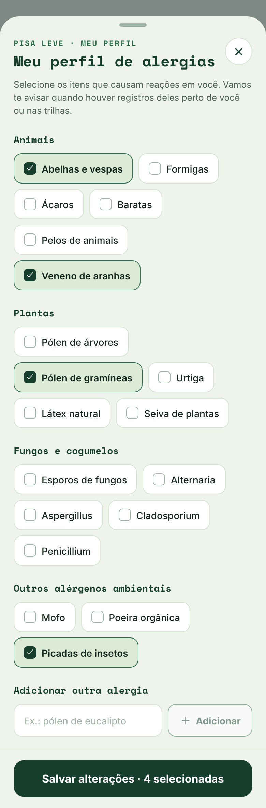
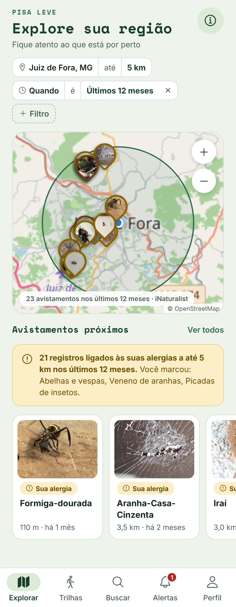
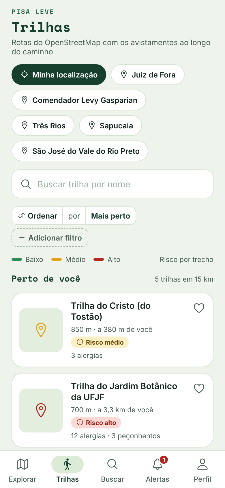
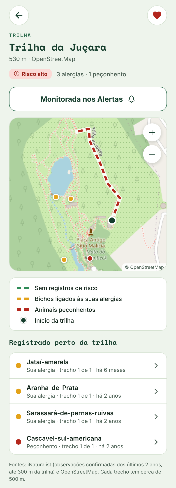
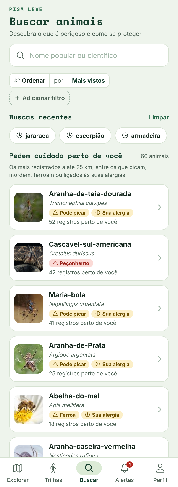
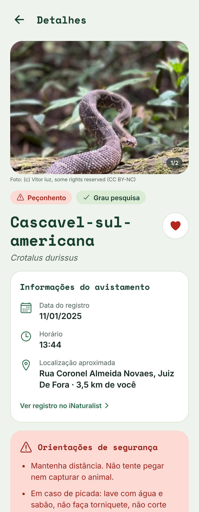
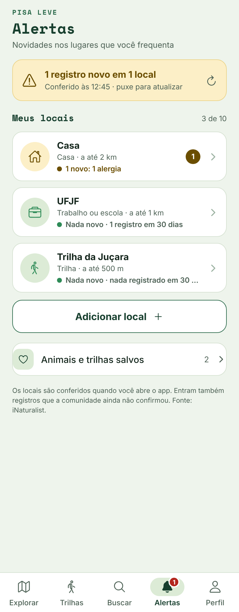
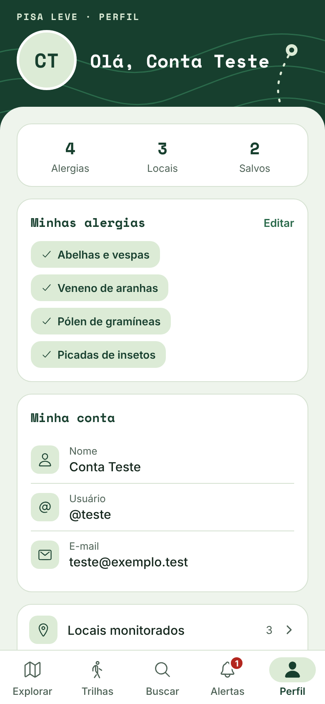

<h1 align="center">🥾 Pisa Leve</h1>

<p align="center">
  <strong>Saiba o que está por perto antes de dar o próximo passo.</strong><br>
  Animais peçonhentos e ligados às suas alergias registrados perto de você e ao longo das trilhas, com avisos de acordo com o seu perfil de alergias.
</p>

<p align="center">
  
  
  
  
</p>

## 📱 Sobre o projeto

O Pisa Leve é um aplicativo para celular que ajuda a evitar acidentes com animais peçonhentos e reações alérgicas. Ele cruza registros reais de ciência cidadã (iNaturalist) e trilhas do OpenStreetMap com as alergias que o próprio usuário marcou:

- 🗺️ **Explorar:** mapa com os avistamentos confirmados perto de você (pins com a foto do animal), filtros de raio, período, grupo e risco, e aviso quando há registros ligados às suas alergias.
- 🥾 **Trilhas com risco por trecho:** a trilha é dividida em trechos de ~500 m e cada um aparece em verde (sem registros), amarelo (bicho ligado à sua alergia) ou vermelho (peçonhento), com base nos últimos 2 anos. Dá para ver as trilhas perto de você ou nas 5 cidades mais próximas que têm trilha mapeada, e favoritar.
- 🔎 **Buscar animais** pelo nome popular ou científico. Sem nada digitado, mostra os animais que pedem cuidado perto de você. Guarda as buscas recentes.
- 🐍 **Detalhe do animal:** foto, dados do avistamento, selos de perigo e orientações de segurança por grupo (cobras, aranhas, escorpiões, lagartas, abelhas e vespas…), com botão para ligar para o SAMU (192).
- 🤧 **Perfil de alergias:** no primeiro acesso você marca o que causa reação em você; os avisos do app levam isso em conta.
- 🔔 **Alertas por local:** acompanhe até 10 lugares (casa, trabalho ou escola, trilha ou outro), cada um com seu raio, e veja quantos registros novos apareceram desde a última vez. O sino da barra de abas mostra o total.
- ❤️ **Salvos:** animais e trilhas que você guardou, com os números no Perfil.

> ⚠️ As informações têm caráter educativo e vêm de registros voluntários. A falta de registros não significa ausência de risco. Em caso de acidente, ligue para o SAMU (192) e procure atendimento médico imediatamente.

## 🖼️ Telas

<table align="center">
  <tr>
    <td align="center" valign="top" width="25%">
      <br>
      <sub><b>Perfil de alergias</b></sub>
    </td>
    <td align="center" valign="top" width="25%">
      <br>
      <sub><b>Explorar</b></sub>
    </td>
    <td align="center" valign="top" width="25%">
      <br>
      <sub><b>Trilhas</b></sub>
    </td>
    <td align="center" valign="top" width="25%">
      <br>
      <sub><b>Detalhe da trilha</b></sub>
    </td>
  </tr>
  <tr>
    <td align="center" valign="top" width="25%">
      <br>
      <sub><b>Buscar animais</b></sub>
    </td>
    <td align="center" valign="top" width="25%">
      <br>
      <sub><b>Detalhe do animal</b></sub>
    </td>
    <td align="center" valign="top" width="25%">
      <br>
      <sub><b>Alertas</b></sub>
    </td>
    <td align="center" valign="top" width="25%">
      <br>
      <sub><b>Perfil</b></sub>
    </td>
  </tr>
</table>

## 🚀 Como rodar localmente

### Pré-requisitos

| Ferramenta | Versão | Para quê |
|---|---|---|
| Node.js | 22.13 ou superior (LTS) | Rodar o projeto |
| Git | qualquer recente | Clonar o repositório |
| Expo Go | compatível com o SDK 58 | Abrir o app no celular |

### Passo a passo

**1. Clone o repositório**

```bash
git clone https://github.com/LucaRenaultLamas/Pisa-Leve.git
cd Pisa-Leve
```

**2. Instale as dependências**

```bash
npm install
```

**3. Inicie o servidor do Expo**

```bash
npx expo start
```

**4. Abra no celular**

- **Android:** abra o Expo Go e toque em *Scan QR code*.
- **iOS:** aponte a câmera para o QR Code que aparece no terminal.

O celular e o computador precisam estar na mesma rede Wi-Fi. Se a rede bloquear a conexão (comum em redes de faculdade), use:

```bash
npx expo start --tunnel
```

**5. Crie uma conta e permita o acesso à localização** quando o app pedir. É com ela que o mapa, as trilhas e a busca mostram o que está perto de você.

> Também roda no navegador: `npx expo start --web` (ou aperte `w` no terminal do Expo).

### Outros comandos úteis

| Comando | O que faz |
|---|---|
| `npx expo start -c` | Inicia limpando o cache (resolve a maioria dos erros estranhos) |
| `npx expo start --android` | Abre direto no emulador Android |
| `npx expo start --web` | Abre a versão web |
| `npx tsc --noEmit` | Verifica erros de tipagem |
| `npx expo lint` | Roda o ESLint |

## 🧭 Navegação

O app usa o *file-based routing* do Expo Router: cada arquivo em `src/app/` é uma tela e cada `_layout.tsx` define um navegador.

| Navegador | Arquivo | Telas |
|---|---|---|
| Stack (raiz) | `src/app/_layout.tsx` | Entrar e Criar conta (só sem login), abas, detalhes do animal e da trilha, Novo local (modal) e Alergias (popup) |
| Tabs (barra inferior) | `src/app/(tabs)/_layout.tsx` (celular, abas nativas) e `_layout.web.tsx` (web, com ícones) | Explorar · Trilhas · Buscar · Alertas · Perfil |
| Stack da aba Alertas | `src/app/(tabs)/alertas/_layout.tsx` | Alertas → Local monitorado e Salvos |

As telas do app ficam atrás de `Stack.Protected`: sem login, só aparecem Entrar e Criar conta.

<details>
<summary><strong>📂 Estrutura de pastas</strong></summary>

```
src/
├── app/                          Rotas (telas)
│   ├── _layout.tsx               Stack raiz
│   ├── login.tsx                 /login
│   ├── registrar.tsx             /registrar
│   ├── onboarding.tsx            /onboarding (popup de alergias)
│   ├── (tabs)/
│   │   ├── _layout.tsx           Tabs (celular)
│   │   ├── _layout.web.tsx       Tabs (web)
│   │   ├── index.tsx             /           Explorar
│   │   ├── trilhas.tsx           /trilhas
│   │   ├── busca.tsx             /busca
│   │   ├── perfil.tsx            /perfil
│   │   └── alertas/
│   │       ├── _layout.tsx       Stack
│   │       ├── index.tsx         /alertas
│   │       ├── salvos.tsx        /alertas/salvos
│   │       └── local/[id].tsx    /alertas/local/:id
│   ├── animal/[id].tsx           /animal/:id
│   ├── trilha/[id].tsx           /trilha/:id
│   └── local/novo.tsx            /local/novo (modal)
├── components/                   Componentes reutilizáveis (cartões, mapas, filtros, popups…)
├── constants/                    Tema, alergias, animais peçonhentos, orientações de segurança, trilhas de JF
├── contexts/                     Sessão, favoritas e alertas
├── hooks/                        useAoEntrar
├── services/                     Requisições (fetch) e AsyncStorage
├── types/                        Tipos extras (SVG)
└── utils/                        Distâncias, datas, textos e validação
```

</details>

## 🌐 Fontes de dados

| Fonte | Uso |
|---|---|
| [iNaturalist API](https://api.inaturalist.org/v1/docs/) | Avistamentos, espécies, fotos e nomes em português |
| [Nominatim](https://nominatim.org/) (OpenStreetMap) | Busca rápida de trilhas e cidades vizinhas com trilha |
| [Overpass API](https://overpass-api.de/) (OpenStreetMap) | Lista completa das trilhas e seus traçados |
| Mapas do OpenStreetMap | Fundo dos mapas na versão web |
| Ministério da Saúde e Instituto Butantan | Base das orientações de segurança |

## 🛠️ Tecnologias

React Native · Expo · Expo Router · TypeScript · expo-location · react-native-maps · AsyncStorage · expo-crypto · react-native-svg

## 👥 Autores

Luca Renault Lamas – Desenvolvimento<br>
Lourenço Dutra – Desenvolvimento

Trabalho final da disciplina de Desenvolvimento Móvel, com orientação do professor Victor Vidigal Ribeiro.
